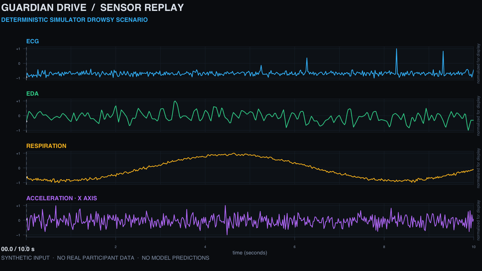
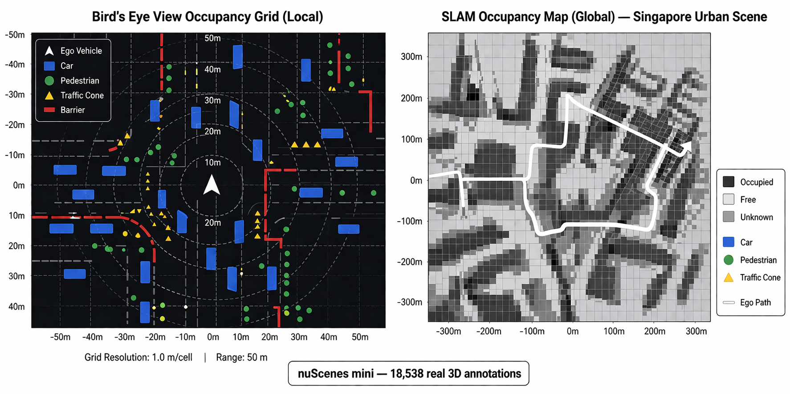
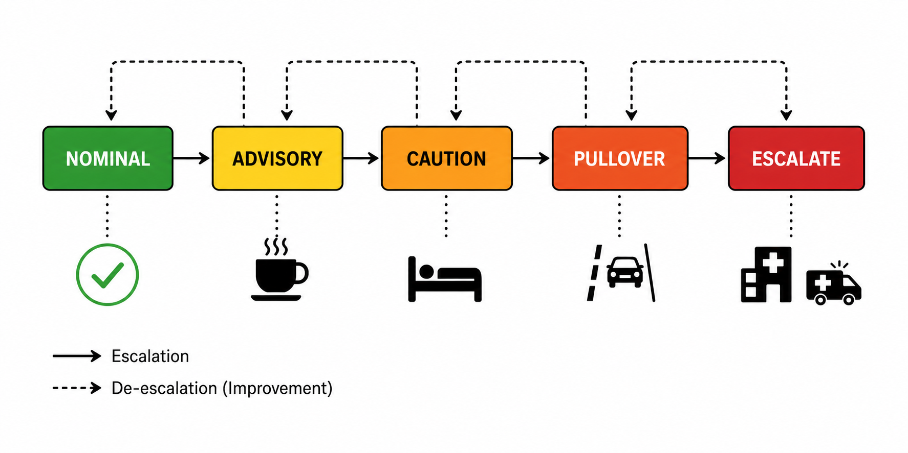

<div align="center">

# Guardian Drive

**A research prototype for sensor-aware driving safety systems**

[](https://github.com/AKilalours/guardian-drive/actions/workflows/ci.yml)


[Watch the synthetic sensor replay](docs/media/guardian-synthetic-replay.mp4) ·
[Run the interactive dashboard locally](#run-the-interactive-dashboard) ·
[Explore the WESAD diffusion code](#conditional-diffusion-for-wesad)

<a href="docs/media/guardian-synthetic-replay.mp4"></a>

<sub>The replay is generated from Guardian Drive's deterministic simulator. It contains synthetic signals only: no participant data and no model predictions.</sub>

</div>

---

## What this project is

Guardian Drive combines a deterministic multi-sensor simulator, a WebSocket dashboard, driving-perception experiments, and a conditional diffusion prototype for wearable time-series. It is a portfolio and research prototype, not a deployed vehicle safety system.

The most role-relevant work is the WESAD conditional 1D DDPM in [`generative/wesad_diffusion.py`](generative/wesad_diffusion.py). It prepares 10-second wrist-sensor windows, uses separate training, validation, and reserved test participants, fits normalization on training participants only, and supports classifier-free guidance and EMA sampling. Two evaluation paths are provided: [`generative/evaluate_wesad_fidelity.py`](generative/evaluate_wesad_fidelity.py) measures class-conditional signal statistics on reserved participants, while [`generative/evaluate_wesad_augmentation.py`](generative/evaluate_wesad_augmentation.py) compares real-only training with real-plus-synthetic augmentation on the same reserved test split.

> **WESAD experiment status:** A local, participant-disjoint WESAD run has been completed and its protocol, measured results, and limitations are documented in [`docs/research/wesad-ddpm-evaluation.md`](docs/research/wesad-ddpm-evaluation.md). The raw dataset, checkpoints, and generated windows are not included. The current experiment does not show a downstream augmentation benefit.

## Visual tour

<table>
  <tr>
    <td width="50%"><a href="docs/media/bev-slam-overview.png"></a></td>
    <td width="50%"><a href="docs/media/safety-state-machine.png"></a></td>
  </tr>
  <tr>
    <td align="center"><sub>BEV and occupancy-map visual from the project materials. Static illustration; not a live camera feed.</sub></td>
    <td align="center"><sub>Safety-state design diagram; it does not represent a validated medical or vehicle-control policy.</sub></td>
  </tr>
</table>

## Run the interactive dashboard

The dashboard is interactive when run with the local WebSocket backend. The included scenarios use synthetic simulator inputs; they are useful for exercising the UI and pipeline, not for measuring real-world detection performance.

```bash
git clone https://github.com/AKilalours/guardian-drive.git
cd guardian-drive
python3 -m pip install -r requirements.txt
```

Start the backend in one terminal:

```bash
python3 backend_server.py
```

Start a scenario in a second terminal and leave it running. Open the dashboard from a third terminal:

```bash
python3 main.py --scenario drowsy --gps mock --no-webcam --duration 30
# in a third terminal, from the repository root
open guardian_dreamview_fresh.html
```

Try `normal`, `drowsy`, or `crash_severe` with `--scenario`. These are simulated scenarios, not real events or medical states.

## Conditional diffusion for WESAD

The denoiser is a class-conditional 1D U-Net for BVP, EDA, temperature, and three-axis acceleration. Its default participant split is training S2-S9/S14/S17, validation S10-S11, and reserved test S13/S15/S16. The training command never loads the reserved test signals. Normalization is fitted on training participants only. The model also uses class balancing, classifier-free condition dropout/guidance, exponential-moving-average weights, a cosine forward noise schedule, and a 50-step DDIM sampler by default. Training automatically uses CUDA, Apple Metal Performance Shaders (MPS), or CPU, in that order.

Training and evaluation require a local WESAD copy obtained under its dataset terms. WESAD is for scientific, non-commercial use with attribution; do not commit or redistribute the dataset. See the [official dataset page](https://ubi29.informatik.uni-siegen.de/usi/data_wesad.html).

```bash
python -m generative.wesad_diffusion \
  --wesad-root /path/to/WESAD \
  --epochs 50 \
  --diffusion-steps 1000 \
  --sampling-steps 50 \
  --samples-per-class 500

python -m generative.evaluate_wesad_fidelity \
  --wesad-root /path/to/WESAD \
  --checkpoint outputs/wesad_conditional_ddpm.pt \
  --synthetic outputs/wesad_conditional_ddpm_synthetic.npz \
  --synthetic-per-class 500

python -m generative.evaluate_wesad_augmentation \
  --wesad-root /path/to/WESAD \
  --checkpoint outputs/wesad_conditional_ddpm.pt \
  --synthetic outputs/wesad_conditional_ddpm_synthetic.npz \
  --synthetic-per-class 500
```

The fidelity report includes per-channel distribution shifts, Wasserstein distance, log-spectral distance, autocorrelation error, cross-channel correlation error, and participant-bootstrap intervals, broken out by class. These are descriptive diagnostics without validated pass thresholds. The augmentation report measures per-test-participant balanced accuracy and macro-F1 with paired bootstrap intervals. Both scripts enforce separation from the generator's training and validation participants. The linked evaluation report records the current result and its limitations; generated signals must not be presented as real measurements.

### First held-out run

The generator selects the EMA checkpoint with the lowest noise-prediction loss on a fixed validation corruption set. In the seed-42 run, this was epoch 50. Training used S2–S9/S14/S17; validation used S10/S11; final evaluation used reserved participants S13/S15/S16.

| Evaluation | Real-only | Real + synthetic | Change (95% participant-bootstrap interval) |
|---|---:|---:|---:|
| Balanced accuracy | 0.462 | 0.456 | −0.005 (−0.099 to 0.056) |
| Macro-F1 | 0.342 | 0.324 | −0.018 (−0.104 to 0.038) |

Signal-fidelity diagnostics also remain poor: mean absolute channel-mean shift 13.80, standard-deviation ratio error 42.54, and log-spectral distance 36.30 dB. This small, single-seed experiment shows no augmentation benefit. WESAD contains lab-collected stress and affect data, not driving or fatigue data. See the [full protocol and limitations](docs/research/wesad-ddpm-evaluation.md).

**What the pipeline demonstrates:** participant-disjoint data handling, training-only normalization, cosine-schedule conditional diffusion, classifier-free guidance, EMA checkpoint selection on validation participants, accelerated DDIM sampling, and separate signal-fidelity and downstream-utility evaluations. It does not demonstrate production-ready synthetic signals.

Dataset citation: P. Schmidt, A. Reiss, R. Duerichen, C. Marberger, and K. Van Laerhoven, “Introducing WESAD: a Multimodal Dataset for Wearable Stress and Affect Detection,” ICMI 2018, doi: [10.1145/3242969.3242985](https://doi.org/10.1145/3242969.3242985).

Sampler reference: J. Song, C. Meng, and S. Ermon, “Denoising Diffusion Implicit Models,” ICLR 2021, [arXiv:2010.02502](https://arxiv.org/abs/2010.02502).

## Evidence and limitations

- The CI workflow runs unit and smoke checks, validates tracked benchmark-result files, and checks the fusion weights.
- Individual experiment artifacts are under [`outputs/`](outputs/); read each artifact's protocol and source before quoting a metric.
- The earlier WESAD TCN window-level AUC of 0.9738 is flagged for subject leakage; the documented LOSO AUC is 0.6712 ([`policy/medical_guardrail.py`](policy/medical_guardrail.py)). These are baseline results, separate from the diffusion experiment, and are not presented as deployment evidence.
- The deterministic generator in [`acquisition/simulator.py`](acquisition/simulator.py) is synthetic. It is not a physiological or multiphysics model.
- No clinical validation, prospective road testing, safety certification, or COMSOL multiphysics validation is claimed.

## Repository map

| Area | Path |
|---|---|
| Conditional wearable diffusion | [`generative/`](generative/) |
| Synthetic sensor simulator | [`acquisition/simulator.py`](acquisition/simulator.py) |
| Dashboard | [`guardian_dreamview_fresh.html`](guardian_dreamview_fresh.html), [`backend_server.py`](backend_server.py) |
| BEV perception and driving experiments | [`bev_perception/`](bev_perception/), [`evaluation/`](evaluation/) |
| CI smoke tests | [`tests/`](tests/), [`.github/workflows/ci.yml`](.github/workflows/ci.yml) |
| Experiment artifacts | [`outputs/`](outputs/) |
| Safety notes | [`docs/SAFETY.md`](docs/SAFETY.md) |

## Rebuild the README replay

The embedded GIF and MP4 are rendered from `acquisition.simulator` with a fixed seed and are labeled synthetic. To regenerate them on macOS with Python dependencies installed, plus R base graphics and FFmpeg:

```bash
python3 scripts/make_readme_demo.py
```

## Safety note

This repository is for research and demonstration. It does not diagnose, predict, or treat medical conditions, and it must not be used to make clinical decisions or control a vehicle. Simulator labels and generated signals are illustrative only.

---

<div align="center">
<sub>Akila Lourdes Miriyala Francis · Akilan Manivannan</sub>
</div>
