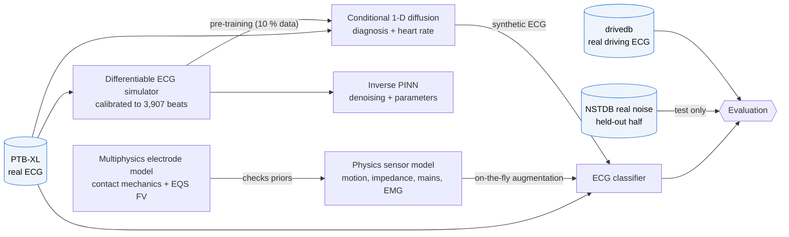
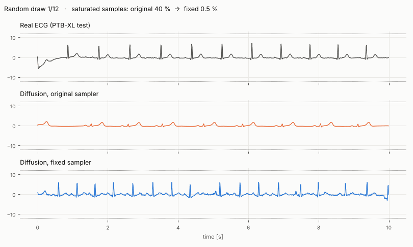
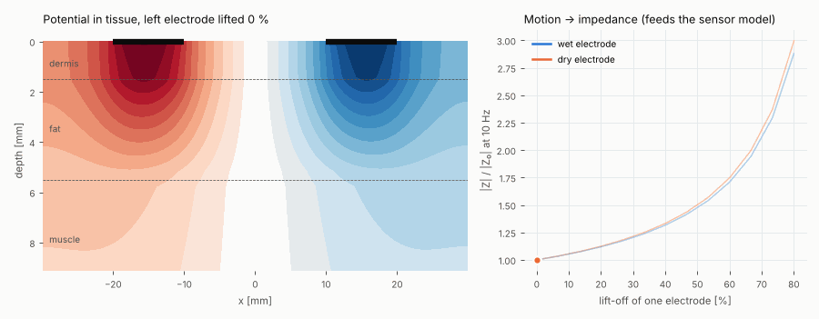
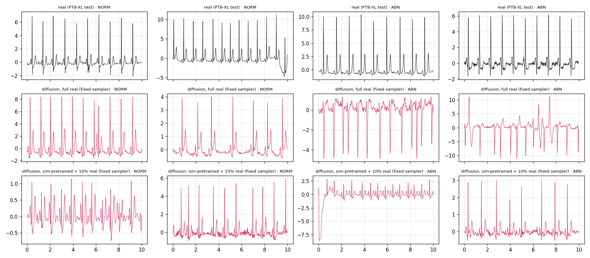
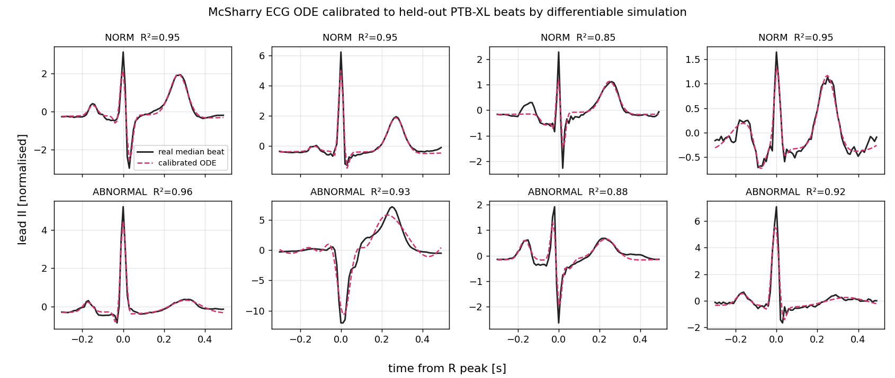
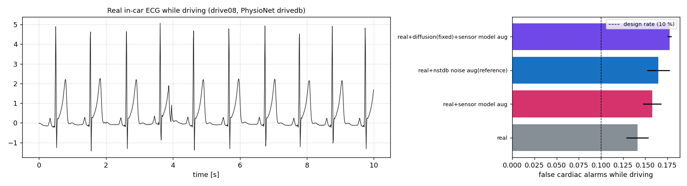

<div align="center">

# Guardian Drive

**A research prototype for sensor-aware driving safety systems**

[](https://github.com/AKilalours/guardian-drive/actions/workflows/ci.yml)


[Watch the synthetic sensor replay](docs/media/guardian-synthetic-replay.mp4) ·
[Run the interactive dashboard locally](#run-the-interactive-dashboard) ·
[Simulation + generative models for ECG](#simulation-and-generative-models-for-wearable-ecg-sensing_gen) ·
[Technical report (PDF)](docs/sensing_gen_report.pdf) ·
[WESAD diffusion prototype](#conditional-diffusion-for-wesad)

<a href="docs/media/guardian-synthetic-replay.mp4"></a>

<sub>The replay is generated from Guardian Drive's deterministic simulator. It contains synthetic signals only: no participant data and no model predictions.</sub>

</div>

## 60-second tour

<p align="center">
  <a href="https://akilalours.github.io/guardian-drive/explorer.html"><b>Open the interactive results explorer →</b></a><br>
  <sub>Toggle noise levels, compare samplers, drag an electrode off the skin, and draw random generated ECG. Every number comes from a result file in this repo.</sub>
</p>

<p align="center">
  
  
  
  
</p>

| If you have… | Start here |
|---|---|
| 1 minute | the [interactive explorer](https://akilalours.github.io/guardian-drive/explorer.html) and the two animations below |
| 5 minutes | [Headline results](#headline-results) and the expandable experiment cards |
| 15 minutes | the [4-page technical report](docs/sensing_gen_report.pdf) |
| an afternoon | `bash scripts/run_sensing_gen.sh` reproduces everything on a laptop |

---

## What this project is

Guardian Drive combines a deterministic multi-sensor simulator, a WebSocket dashboard, driving-perception experiments, and a conditional diffusion prototype for wearable time-series. It is a portfolio and research prototype, not a deployed vehicle safety system.

The most role-relevant work is [`sensing_gen/`](sensing_gen/): simulation and generative models for wearable ECG, evaluated on real PTB-XL ECG corrupted with *real* recorded sensor noise (MIT-BIH NSTDB) under a leakage-free protocol. It contains a differentiable ECG physics simulator, an electro-mechanical electrode–skin multiphysics model, a physics-based sensor/artifact model, an inverse PINN and a conditional 1-D diffusion model. Every number below links to the file that produced it. An earlier conditional-diffusion prototype for multichannel WESAD wrist signals is documented further down; it reports a negative result.

> **WESAD experiment status:** A local, participant-disjoint WESAD run has been completed and its protocol, measured results, and limitations are documented in [`docs/research/wesad-ddpm-evaluation.md`](docs/research/wesad-ddpm-evaluation.md). The raw dataset, checkpoints, and generated windows are not included. The current experiment does not show a downstream augmentation benefit.

## Headline results

| result | value | source |
|---|---|---|
| **Physics sensor-model augmentation**, AUROC under *real* 0 dB sensor noise (held out) | **0.654 → 0.818** (beats real-noise augmentation, 0.807) | [`downstream_results.json`](outputs/sensing_gen/downstream_results.json) |
| Diffusion samples + sensor model, AUROC clean / 0 dB noise | **0.838 / 0.827** (3 seeds) | [`guidance_results.json`](outputs/sensing_gen/guidance_results.json) |
| Diffusion sampler bug diagnosed and fixed (no retraining) | saturated samples **40 % → 0.5 %**; real-vs-fake discriminator **0.96 → 0.63** | same |
| Train-on-synthetic-test-on-real (diffusion) vs train-on-real | **0.829** vs 0.801 AUROC | same |
| Differentiable ECG simulator calibrated to real beats | **3,907 beats, median R² 0.951** | [`calibration_results.json`](outputs/sensing_gen/calibration_results.json) |
| Electrode–skin multiphysics FV solver, analytic verification | error **2×10⁻⁴**; wet 21.5 kΩ vs dry 443 kΩ at 10 Hz | [`multiphysics_results.json`](outputs/sensing_gen/multiphysics_results.json) |
| Inverse PINN, real ECG + real noise at 0 dB | **7.7 dB** vs 6.3 dB band-pass (filtering wins at ≥ 6 dB) | [`pinn_results.json`](outputs/sensing_gen/pinn_results.json) |
| Real in-car ECG (PhysioNet drivedb, 18 drives), false cardiac alarms at a 10 % design rate | **13.9 %** (transfers); augmentation gives no further gain (driver-bootstrap CIs include 0) | [`driving_results.json`](outputs/sensing_gen/driving_results.json) |
| CARLA 0.9.15, 7 town scenarios | **320 → 2** collisions vs no intervention | [`carla_real_evaluation_results.json`](outputs/carla_real_evaluation_results.json) |
| Behavior cloning vs rule-based expert (CARLA) | reward 705.5 vs 711.4; safety accuracy 98.1 % vs 98.3 % | [`carla_agent/eval_results.json`](outputs/carla_agent/eval_results.json) |
| Cardiac screen (Task A), PTB-XL 12-lead, 800-record run | AUC **0.8545** | [`ptbxl_cardiac_results.json`](outputs/ptbxl_cardiac_results.json) |
| Tests | unit + Hypothesis property + sensing_gen suites in CI | [`.github/workflows/ci.yml`](.github/workflows/ci.yml) |

## Simulation and generative models for wearable ECG (`sensing_gen/`)

Wearable physiological signals are scarce, expensive to label and dominated by motion artifacts.
`sensing_gen` builds the tools to scale training data beyond what collection alone provides, and
to *measure* whether the extra data helps:

* **Differentiable physics simulator.** The McSharry ECG dynamical model in PyTorch, with an exact
  FFT-based exponential integrator, cardio-respiratory coupling, and calibration to thousands of
  real PTB-XL beats by gradient descent *through the simulator*.
* **Physics-based sensor model.** Electrode–skin interface in a moving vehicle: seat/torso
  mechanics → skin-stretch potential, impedance-modulated gain, impedance-mismatch mains pickup,
  EMG bursts, contact loss and ADC effects. Batched, used as on-the-fly augmentation.
* **Inverse PINN.** Recovers the clean ECG *and* the ODE parameters from noisy recordings, with
  autograd ODE residuals at stochastic collocation points. Segments are solved in parallel.
* **Conditional 1-D diffusion model.** A U-Net with FiLM conditioning on diagnosis and heart rate,
  DDPM training, DDIM sampling and classifier-free guidance, plus simulation pre-training for the
  low-data regime.
* **Multiphysics electrode model.** Contact mechanics coupled to an electro-quasi-static
  finite-volume solver for layered tissue, verified against an analytic solution. It predicts
  wet vs dry electrode impedance and motion sensitivity.
* **Evaluation.** Fréchet / MMD / spectral / heart-rate fidelity, discriminative score,
  train-on-synthetic-test-on-real, and downstream AUROC under *real* recorded sensor noise
  (MIT-BIH NSTDB, held-out half).

Full method, protocol, result tables, negative results and limitations:
**[sensing_gen/README.md](sensing_gen/README.md)** · technical report: **[docs/sensing_gen_report.pdf](docs/sensing_gen_report.pdf)**.

```bash
bash scripts/run_sensing_gen.sh        # download data -> tests -> smoke run -> full run (~4 h, Apple MPS)
python -m sensing_gen.data.download --drivedb-only && python -m sensing_gen.experiments.run_all multiphysics sensor_ablation guidance driving
```

### How the pieces fit



<table>
  <tr>
    <td width="50%"></td>
    <td width="50%"></td>
  </tr>
  <tr>
    <td align="center"><sub><b>The sampler bug, live.</b> Random (not cherry-picked) draws. The original sampler pins 40 % of samples to the rail; the fix brings that to 0.5 % with no retraining.</sub></td>
    <td align="center"><sub><b>Multiphysics.</b> As one electrode lifts, current crowds under its smaller footprint and |Z| rises 12 % at 20 % lift-off, the coupling the sensor model simulates.</sub></td>
  </tr>
</table>

### Experiment cards

<details>
<summary><b>1 · Robustness:</b> physics sensor simulation beats real-noise augmentation (0 dB AUROC 0.654 → 0.818)</summary>

| training (100 % PTB-XL, 3 seeds) | clean | 6 dB real noise | 0 dB real noise |
|---|---|---|---|
| real only | 0.812 | 0.762 | 0.654 |
| + real NSTDB noise (reference) | 0.823 | 0.820 | 0.807 |
| + physics sensor model | 0.833 | 0.829 | 0.818 |
| **+ diffusion samples + sensor model** | **0.838** | **0.834** | **0.827** |

The sensor model never sees NSTDB; the test noise is the held-out half of every NSTDB recording. [`downstream_results.json`](outputs/sensing_gen/downstream_results.json) · [`guidance_results.json`](outputs/sensing_gen/guidance_results.json)
</details>

<details>
<summary><b>2 · Diffusion:</b> a sampler bug diagnosed and fixed without retraining (40 % → 0.5 % broken samples)</summary>

Guidance was ruled out by a sweep (still 39 % broken at w = 0). Root cause: DDIM started at t = T−1, where the cosine schedule leaves ᾱ ≈ 2.4×10⁻⁹ and the x̂₀ estimate multiplies ε-error ~20,000×. Leading timesteps plus dynamic thresholding, selected on validation:

| | original sampler | fixed sampler |
|---|---|---|
| saturated samples | 40 % | 0.5 % |
| real-vs-fake discriminator accuracy (0.5 ideal) | 0.96 | 0.63 |
| train-on-synthetic, test-on-real AUROC | 0.819 | **0.829** (real data: 0.801) |


</details>

<details>
<summary><b>3 · Physics + multiphysics:</b> simulator fitted to 3,907 real beats; electrode model verified to 2×10⁻⁴</summary>



* Median R² 0.951 (IQR 0.91–0.97) over 3,907 real median beats, fitted by gradient descent through the simulator.
* Electrode model: analytic thin-strip error 2×10⁻⁴, reciprocity 10⁻¹⁰, grid convergence 7×10⁻⁵; wet 21.5 kΩ vs dry 443 kΩ at 10 Hz.
* Null result: multiphysics-derived sensor priors did not improve the classifier (0.801 vs 0.818 at 0 dB).

<!-- COMSOL-CHECK:BEGIN -->
**COMSOL cross-check:** not run yet. The [step-by-step guide](sensing_gen/multiphysics/comsol/README.md) and `python -m sensing_gen.multiphysics.compare_comsol` will fill this line with the measured agreement.
<!-- COMSOL-CHECK:END -->
</details>

<details>
<summary><b>4 · Real driving ECG:</b> the model transfers (13.9 % vs 12.4 % false alarms), augmentation adds nothing</summary>



18 drives on real roads (PhysioNet drivedb), 7,995 ten-second windows, thresholds fixed on clinical validation data. All augmentations leave in-car false alarms unchanged within noise (driver-bootstrap CIs include 0). Alarms concentrate in a few drivers, so electrode placement, not noise, is the remaining gap. [`driving_results.json`](outputs/sensing_gen/driving_results.json)
</details>

<details>
<summary><b>5 · Inverse PINN:</b> physics wins only when noise dominates</summary>

| input SNR (real ECG + real noise) | band-pass | PINN λ=0.1 | diff-sim (hard) |
|---|---|---|---|
| 0 dB | 6.3 dB | 7.7 dB | 7.7 dB |
| 6 dB | **13.9 dB** | 12.2 dB | 8.0 dB |
| 12 dB | **21.0 dB** | 16.3 dB | 8.4 dB |

On simulated data the PINN recovers P/T-wave parameters within 4–9 %. [`pinn_results.json`](outputs/sensing_gen/pinn_results.json)
</details>

## Visual tour

<table>
  <tr>
    <td width="50%"><a href="docs/media/bev-slam-overview.png"></a></td>
    <td width="50%"><a href="docs/media/safety-state-machine.png"></a></td>
  </tr>
  <tr>
    <td align="center"><sub>BEV and occupancy-map visual from the project materials. Static illustration; not a live camera feed.</sub></td>
    <td align="center"><sub>Safety-state design diagram; it does not represent a validated medical or vehicle-control policy.</sub></td>
  </tr>
</table>

## Run the interactive dashboard

The dashboard is interactive when run with the local WebSocket backend. The included scenarios use synthetic simulator inputs; they are useful for exercising the UI and pipeline, not for measuring real-world detection performance.

```bash
git clone https://github.com/AKilalours/guardian-drive.git
cd guardian-drive
python3 -m pip install -r requirements.txt
```

Start the backend in one terminal:

```bash
python3 backend_server.py
```

Start a scenario in a second terminal and leave it running. Open the dashboard from a third terminal:

```bash
python3 main.py --scenario drowsy --gps mock --no-webcam --duration 30
# in a third terminal, from the repository root
open guardian_dreamview_fresh.html
```

Try `normal`, `drowsy`, or `crash_severe` with `--scenario`. These are simulated scenarios, not real events or medical states.

## Conditional diffusion for WESAD

The denoiser is a class-conditional 1D U-Net for BVP, EDA, temperature, and three-axis acceleration. Its default participant split is training S2-S9/S14/S17, validation S10-S11, and reserved test S13/S15/S16. The training command never loads the reserved test signals. Normalization is fitted on training participants only. The model also uses class balancing, classifier-free condition dropout/guidance, exponential-moving-average weights, a cosine forward noise schedule, and a 50-step DDIM sampler by default. Training automatically uses CUDA, Apple Metal Performance Shaders (MPS), or CPU, in that order.

Training and evaluation require a local WESAD copy obtained under its dataset terms. WESAD is for scientific, non-commercial use with attribution; do not commit or redistribute the dataset. See the [official dataset page](https://ubi29.informatik.uni-siegen.de/usi/data_wesad.html).

```bash
python -m generative.wesad_diffusion \
  --wesad-root /path/to/WESAD \
  --epochs 50 \
  --diffusion-steps 1000 \
  --sampling-steps 50 \
  --samples-per-class 500

python -m generative.evaluate_wesad_fidelity \
  --wesad-root /path/to/WESAD \
  --checkpoint outputs/wesad_conditional_ddpm.pt \
  --synthetic outputs/wesad_conditional_ddpm_synthetic.npz \
  --synthetic-per-class 500

python -m generative.evaluate_wesad_augmentation \
  --wesad-root /path/to/WESAD \
  --checkpoint outputs/wesad_conditional_ddpm.pt \
  --synthetic outputs/wesad_conditional_ddpm_synthetic.npz \
  --synthetic-per-class 500
```

The fidelity report includes per-channel distribution shifts, Wasserstein distance, log-spectral distance, autocorrelation error, cross-channel correlation error, and participant-bootstrap intervals, broken out by class. These are descriptive diagnostics without validated pass thresholds. The augmentation report measures per-test-participant balanced accuracy and macro-F1 with paired bootstrap intervals. Both scripts enforce separation from the generator's training and validation participants. The linked evaluation report records the current result and its limitations; generated signals must not be presented as real measurements.

### First held-out run

The generator selects the EMA checkpoint with the lowest noise-prediction loss on a fixed validation corruption set. In the seed-42 run, this was epoch 50. Training used S2–S9/S14/S17; validation used S10/S11; final evaluation used reserved participants S13/S15/S16.

| Evaluation | Real-only | Real + synthetic | Change (95% participant-bootstrap interval) |
|---|---:|---:|---:|
| Balanced accuracy | 0.462 | 0.456 | −0.005 (−0.099 to 0.056) |
| Macro-F1 | 0.342 | 0.324 | −0.018 (−0.104 to 0.038) |

Signal-fidelity diagnostics also remain poor: mean absolute channel-mean shift 13.80, standard-deviation ratio error 42.54, and log-spectral distance 36.30 dB. This small, single-seed experiment shows no augmentation benefit. WESAD contains lab-collected stress and affect data, not driving or fatigue data. See the [full protocol and limitations](docs/research/wesad-ddpm-evaluation.md).

**What the pipeline demonstrates:** participant-disjoint data handling, training-only normalization, cosine-schedule conditional diffusion, classifier-free guidance, EMA checkpoint selection on validation participants, accelerated DDIM sampling, and separate signal-fidelity and downstream-utility evaluations. It does not demonstrate production-ready synthetic signals.

Dataset citation: P. Schmidt, A. Reiss, R. Duerichen, C. Marberger, and K. Van Laerhoven, “Introducing WESAD: a Multimodal Dataset for Wearable Stress and Affect Detection,” ICMI 2018, doi: [10.1145/3242969.3242985](https://doi.org/10.1145/3242969.3242985).

Sampler reference: J. Song, C. Meng, and S. Ermon, “Denoising Diffusion Implicit Models,” ICLR 2021, [arXiv:2010.02502](https://arxiv.org/abs/2010.02502).

## Safety-escalation policies in CARLA

`carla_agent/` contains a Gym-style environment, a safety-critical reward, and BC / PPO policies.

* **Reward** (`carla_agent/reward/reward_fn.py`): balances missed-alarm cost against false-alarm
  ("cry-wolf") cost, with comfort (jerk) and lane-keeping penalties. Its invariants are checked with
  Hypothesis property tests (`tests/property/test_safety_properties.py`).
* **CARLA 0.9.15, 7 town scenarios** (`outputs/carla_real_evaluation_results.json`): 320 collisions
  without intervention vs 2 with the Guardian escalation machine (six states, eight detectors,
  Kalman-filtered).
* **Policy learning** (`outputs/carla_agent/eval_results.json`, 5 episodes each):

| policy | reward | safety-decision accuracy | collisions / episode |
|---|---|---|---|
| rule-based expert | 711.4 ± 45.9 | 98.3 % | 0.4 |
| behavior cloning | 705.5 ± 56.0 | 98.1 % | 0.2 |
| PPO | 155.7 ± 382.3 | 60.3 % | 0.4 |

BC matches the expert. PPO is unstable on these episodes (very high reward variance), which is
documented rather than hidden.

## Evidence and limitations

- The CI workflow runs unit and smoke checks, validates tracked benchmark-result files, and checks the fusion weights.
- Individual experiment artifacts are under [`outputs/`](outputs/); read each artifact's protocol and source before quoting a metric.
- The earlier WESAD TCN window-level AUC of 0.9738 is flagged for subject leakage; the documented LOSO AUC is 0.6712 ([`policy/medical_guardrail.py`](policy/medical_guardrail.py)). These are baseline results, separate from the diffusion experiment, and are not presented as deployment evidence.
- The deterministic generator in [`acquisition/simulator.py`](acquisition/simulator.py) is a synthetic test fixture. The physiology and multiphysics models live in [`sensing_gen/`](sensing_gen/); the multiphysics model is 2-D, uses nominal literature tissue properties and is written in Python/SciPy (finite volume).
- `sensing_gen` uses resting clinical ECG (PTB-XL, single lead) and NSTDB noise recorded on stationary subjects; negative results (PINN at higher SNR, multiphysics-derived priors) are reported in [`sensing_gen/README.md`](sensing_gen/README.md).
- No clinical validation, prospective road testing, safety certification, or COMSOL multiphysics validation is claimed.

## Repository map

| Area | Path |
|---|---|
| Simulation, multiphysics, PINN, ECG diffusion | [`sensing_gen/`](sensing_gen/), [`docs/sensing_gen_report.pdf`](docs/sensing_gen_report.pdf) |
| WESAD conditional diffusion prototype | [`generative/`](generative/) |
| CARLA environment, reward, BC / PPO | [`carla_agent/`](carla_agent/) |
| Synthetic sensor simulator | [`acquisition/simulator.py`](acquisition/simulator.py) |
| Dashboard | [`guardian_dreamview_fresh.html`](guardian_dreamview_fresh.html), [`backend_server.py`](backend_server.py) |
| BEV perception and driving experiments | [`bev_perception/`](bev_perception/), [`evaluation/`](evaluation/) |
| CI smoke tests | [`tests/`](tests/), [`.github/workflows/ci.yml`](.github/workflows/ci.yml) |
| Experiment artifacts | [`outputs/`](outputs/) |
| Safety notes | [`docs/SAFETY.md`](docs/SAFETY.md) |

## Rebuild the README replay

The embedded GIF and MP4 are rendered from `acquisition.simulator` with a fixed seed and are labeled synthetic. To regenerate them on macOS with Python dependencies installed, plus R base graphics and FFmpeg:

```bash
python3 scripts/make_readme_demo.py
```

## Safety note

This repository is for research and demonstration. It does not diagnose, predict, or treat medical conditions, and it must not be used to make clinical decisions or control a vehicle. Simulator labels and generated signals are illustrative only.

---

<div align="center">
<sub>Akila Lourdes Miriyala Francis · Akilan Manivannan</sub>
</div>
